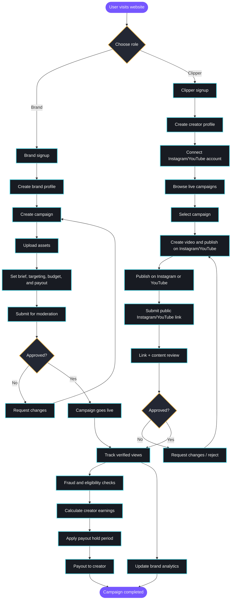

# ClipForge Platform Architecture & User Flows

This document outlines the system architecture, data flow, and user journey workflows for the ClipForge platform.

---

## 1. System Architecture & DFD Diagram

```mermaid
flowchart LR
    V["Visitor"]
    B["Brand / Advertiser"]
    C["Clipper / Creator"]
    A["Admin / Moderator"]
    S["Social Platforms<br/>Instagram · YouTube"]
    P["Payment Provider"]
    E["Email / Notification Service"]

    subgraph PLATFORM["ClipForge Platform"]
        AUTH["1. Authentication & User Management"]
        CAMPAIGN["2. Campaign Management"]
        CONTENT["3. Content & Clip Submission"]
        VERIFY["4. View Verification & Fraud Detection"]
        ANALYTICS["5. Analytics & Reporting"]
        BILLING["6. Billing & Payouts"]
        MODERATION["7. Moderation & Policy"]

        DB[("D1 PostgreSQL Database")]
        STORAGE[("D2 Object Storage<br/>Brand Videos · Logos · Assets")]
        QUEUE[("D3 Background Jobs<br/>Sync · Emails · Payouts")]
    end

    V -->|"Browse pages / sign up"| AUTH
    AUTH -->|"Session / account"| V

    B -->|"Register / create organization"| AUTH
    B -->|"Create brief, budget, targeting"| CAMPAIGN
    CAMPAIGN -->|"Save campaign data"| DB
    B -->|"Upload logos and source videos"| STORAGE
    STORAGE -->|"Asset references"| CAMPAIGN
    CAMPAIGN -->|"Submit for approval"| MODERATION
    MODERATION -->|"Approved campaign"| CAMPAIGN
    CAMPAIGN -->|"Campaign visible to creators"| C

    C -->|"Create profile / connect account"| AUTH
    C -->|"Browse campaigns"| CAMPAIGN
    C -->|"Download approved brand assets"| STORAGE
    C -->|"Submit Instagram/YouTube video link"| CONTENT
    CONTENT -->|"Save link submission"| DB
    CONTENT -->|"Send link for review"| MODERATION
    MODERATION -->|"Approve / reject / request changes"| CONTENT

    CONTENT -->|"Approved Instagram/YouTube post ID"| VERIFY
    VERIFY -->|"Fetch views and engagement"| S
    S -->|"Views, likes, comments, shares"| VERIFY
    VERIFY -->|"Run caps, eligibility, fraud checks"| DB
    VERIFY -->|"Schedule recurring sync"| QUEUE
    QUEUE -->|"Run verification jobs"| VERIFY

    DB -->|"Campaign and view data"| ANALYTICS
    ANALYTICS -->|"Performance dashboard"| B
    ANALYTICS -->|"Earnings and performance"| C
    ANALYTICS -->|"Reports and exports"| A

    B -->|"Add campaign budget"| BILLING
    BILLING -->|"Charge / top up"| P
    P -->|"Payment confirmation"| BILLING
    BILLING -->|"Reserve and track budget"| DB
    VERIFY -->|"Eligible views"| BILLING
    BILLING -->|"Create creator earnings"| DB
    C -->|"Request payout"| BILLING
    BILLING -->|"Send payout"| P
    P -->|"Payout status"| BILLING

    A -->|"Review users, campaigns, clips"| MODERATION
    A -->|"Manage disputes and fraud cases"| VERIFY
    A -->|"Manage balances and payouts"| BILLING
    MODERATION -->|"Audit actions"| DB

    AUTH -->|"Verification and login events"| QUEUE
    MODERATION -->|"Approval and rejection events"| QUEUE
    BILLING -->|"Payment and payout events"| QUEUE
    QUEUE -->|"Send notifications"| E
    E -->|"Email updates"| B
    E -->|"Email updates"| C

    classDef entity fill:#F7F7F4,stroke:#7657FF,color:#111318,stroke-width:2px
    classDef process fill:#181B22,stroke:#4ED9E8,color:#F7F7F4,stroke-width:2px
    classDef database fill:#232733,stroke:#39C88A,color:#F7F7F4,stroke-width:2px
    classDef money fill:#232733,stroke:#F2B84B,color:#F7F7F4,stroke-width:2px
    classDef moderation fill:#232733,stroke:#EE6B78,color:#F7F7F4,stroke-width:2px

    class V,B,C,A,S,P,E entity
    class AUTH,CAMPAIGN,CONTENT,VERIFY,ANALYTICS process
    class BILLING money
    class MODERATION moderation
    class DB,STORAGE,QUEUE database
```



---

## 2. User Journey Flowchart



---

## 2b. Creator link-only rule

- Creators never upload video files to ClipForge. Creator flow is: publish on Instagram or YouTube → submit the public video link → platform validates the link and tracks views via the Instagram/YouTube post ID.
- Only brand source assets (campaign videos, logos, thumbnails, reference examples) are uploaded to D2/R2. Creator videos are represented in D1 only by `postUrl` + `platformPostId` (`instagram` | `youtube`).

---

## 3. Color Palette

```css
:root {
  --ink: #111318;
  --surface: #181B22;
  --surface-muted: #232733;
  --paper: #F7F7F4;
  --violet: #7657FF;
  --cyan: #4ED9E8;
  --green: #39C88A;
  --amber: #F2B84B;
  --red: #EE6B78;
}
```

## 4. Border Radius

```css
:root {
  --radius-sm: 8px;
  --radius-md: 14px;
  --radius-lg: 22px;
  --radius-pill: 999px;
}
```